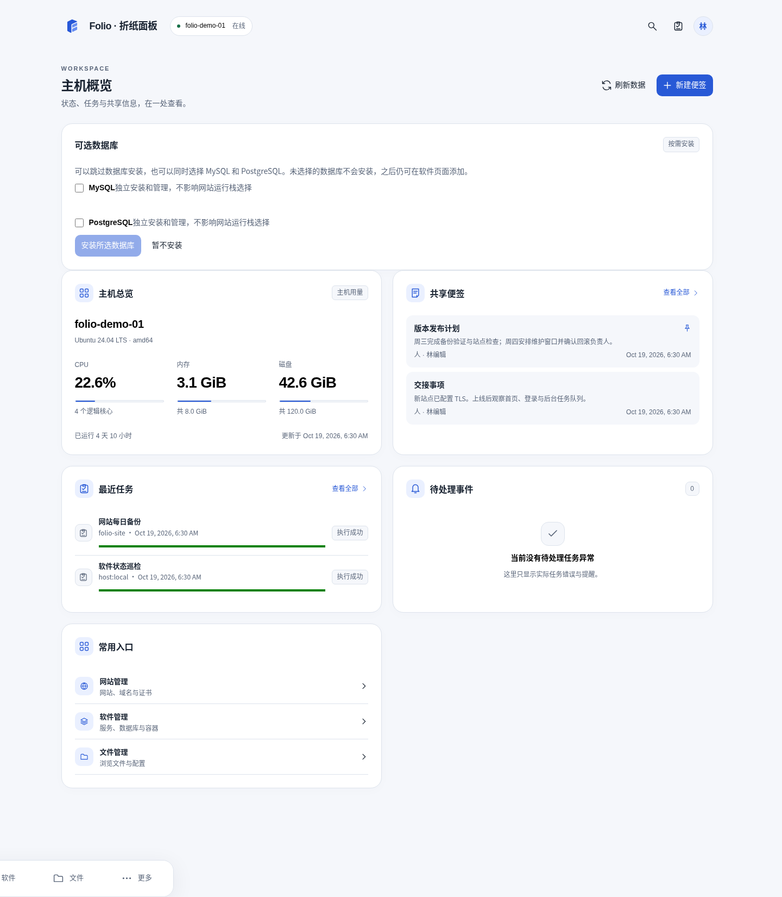
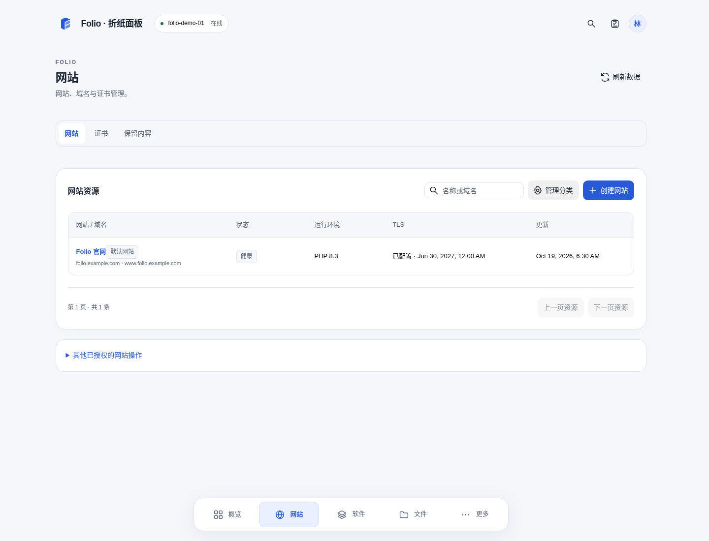
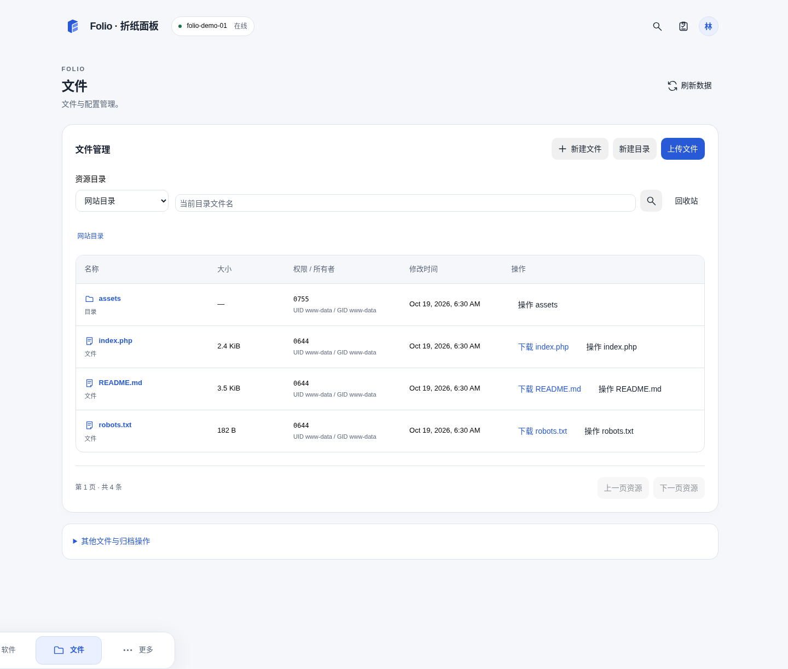
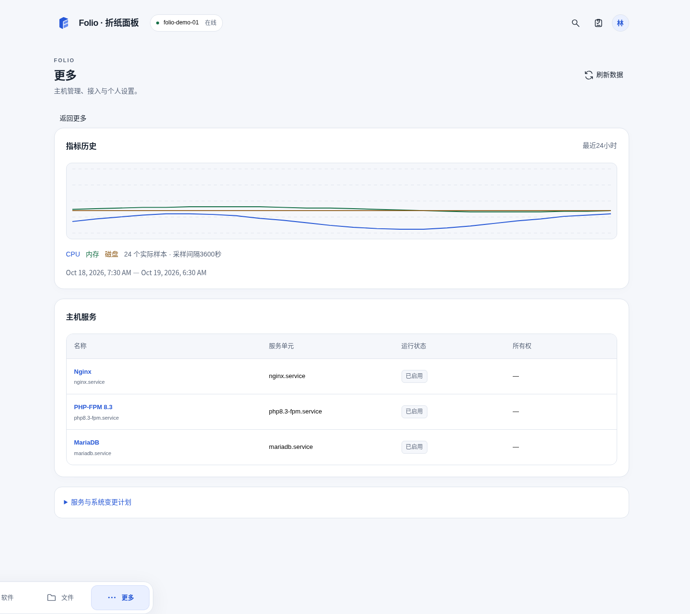

<p align="center">
  
</p>

# Folio · 折纸面板

Folio 是一款用于管理 Linux 服务器的 Web 面板。它把主机状态、网站与软件、文件与终端、计划任务、账户安全和操作审计放在同一个界面中；支持 MCP 的客户端也可以在授权后调用面板提供的能力。

服务端使用 Go，管理界面以静态资源嵌入发行包。运行 Folio 不需要在服务器上常驻 Node.js、Python 或 AI 模型进程。可选的主机执行器默认关闭，只有配置 root 私有策略后才会启用。

## 功能

- 查看主机概览、资源指标、服务状态和共享便签。
- 管理网站、证书和软件目录中的服务。
- 浏览文件，使用受控终端和计划任务。
- 查看数据库与缓存连接、任务进度和操作记录。
- 管理账户安全、会话、MCP 客户端授权和界面主题。

网站与数据库备份不再设置固定总大小上限，仍使用流式处理和完整性校验。计划任务支持数据库备份、最终任务结果、失败通知、重叠执行和错过执行策略。

安装向导和面板支持中英双语。面板可在登录前后切换语言并记住浏览器偏好；切换保留当前页面和输入，资源名称与用户内容保持原文。首页空状态、首次设置、软件变更摘要和任务结果也已完善。

## 界面预览

[查看 beta4 中英文桌面及手机实测截图](docs/screenshots/panel-1.0-beta4/README.md)。

以下 beta1 历史截图展示 5 个重点页面的布局。截图使用隔离的示例数据，不是某台服务器的实时信息。

### 概览

[](docs/screenshots/panel-1.0-beta1/01-overview-full.png)

### 网站

[](docs/screenshots/panel-1.0-beta1/03-sites.png)

### 文件

[](docs/screenshots/panel-1.0-beta1/08-files-full.png)

### 监控

[](docs/screenshots/panel-1.0-beta1/10-more-monitor-full.png)

### MCP 接入

[](docs/screenshots/panel-1.0-beta1/16-more-mcp-full.png)

其余页面见[截图索引（全部 18 个页面）](docs/screenshots/panel-1.0-beta1/README.md)，也可下载[完整截图 ZIP](docs/screenshots/panel-1.0-beta1-screenshots.zip)。

## 安装与首次登录

当前发行版是 [Folio 1.0-beta4](https://github.com/Aoody743/Folio/releases/tag/1.0-beta4)，提供 Linux amd64 安装包和一键安装脚本。在 Ubuntu 24.04 amd64、运行 systemd 的服务器上执行：

```sh
curl -fsSL https://github.com/Aoody743/Folio/releases/download/1.0-beta4/install-1.0-beta4.sh | sudo bash -s -- --lang zh-CN
```

英文安装使用 `--lang en`，无人值守增加 `--yes`；面板语言可在登录页及顶部随时切换。

安装脚本会下载发行包和 `SHA256SUMS.txt`，校验发行包后再运行包内安装器。可以先查看[一键安装脚本](scripts/rewrite/install-1.0-beta4.sh)及[发行校验清单](https://github.com/Aoody743/Folio/releases/download/1.0-beta4/SHA256SUMS.txt)。

安装完成后，服务由 systemd 管理，默认只监听服务器本机的 `127.0.0.1:9000`。在自己的电脑上建立 SSH 隧道：

```sh
ssh -L 9000:127.0.0.1:9000 your-user@your-server
```

保持隧道运行，在浏览器打开 <http://127.0.0.1:9000>。首次设置时，按页面提示从服务器本机管理员控制台取得私有初始化令牌，并设置管理员账号和密码。令牌保存在 `/var/lib/powerlinux/bootstrap-token`；完成设置后会被删除。不要把令牌或密码放进 URL、聊天记录或命令行参数。

可以用下面的命令查看服务状态和健康状态：

```sh
sudo systemctl status powerlinux.service
sudo /opt/powerlinux/current/folio healthcheck \
  --server-config /etc/powerlinux/server.json \
  --expected-version 1.0-beta4
```

默认配置不向公网开放服务。如需通过其他入口访问，请先按[安装与运维手册](scripts/rewrite/README.md)配置并验证 HTTPS、监听地址和允许的来源。

## 更新、回退与卸载

安装器会保留版本快照，并提供更新、回退和卸载流程。卸载会停止并移除 Folio 的服务入口，同时保留数据、配置和快照，方便按需恢复或清理。请按[安装与运维手册](scripts/rewrite/README.md#update-rollback-and-uninstall)中的步骤执行这些操作。

## 本地开发

开发需要仓库指定版本的 Go、Node.js 24 和 npm：

```sh
make rewrite-deps
make rewrite-test
make rewrite-build REWRITE_VERSION=dev
make rewrite-dev
```

常用入口：

- `cmd/powerlinux`：服务器与命令行程序。
- `internal/`：API、授权、任务和主机能力实现。
- `frontend/`：Next.js 静态管理界面。
- `scripts/rewrite/`：构建、安装、升级、回退和卸载工具。

完整参数和运维说明见[构建与安装手册](scripts/rewrite/README.md)。

## 项目文档

- [1.0-beta4 发布说明](.github/release-notes/1.0-beta4.md)
- [当前版本与验收范围](docs/rewrite/CURRENT-RELEASE.md)
- [面板截图索引](docs/screenshots/panel-1.0-beta1/README.md)
- [MCP 接入设计](docs/rewrite/AI-NATIVE-MCP.md)
- [界面设计规范](docs/rewrite/UI-SPEC.md)
- [开发计划](docs/rewrite/DEVELOPMENT-PLAN.md)

仓库仍包含旧版兼容代码；新版界面、产品名称及安装命令统一使用 **Folio**。

## License

本项目采用 Apache License 2.0，详见 [LICENSE](LICENSE)。
