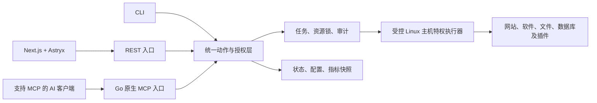

# Folio：AI Native 与原生 MCP

更新：2026-10-17（Asia/Singapore）。这是全新重构方案的必选能力，MCP 服务已接入 Folio 代码；目标主机和第三方客户端的最终验收另行进行。

## 目标

外部 AI 客户端能通过标准 MCP 查询、规划、执行、验证和恢复 Folio 操作。Folio 负责服务器状态、授权、任务、审计和工具执行；模型、对话和规划都在面板外部完成。现有面板功能仍全部进入迁移范围；网页、REST、CLI 与 MCP 调用同一业务动作和任务层。

原生 MCP 使用官方 Go SDK `github.com/modelcontextprotocol/go-sdk`，集成在 Go 发行包中。提供 MCP 不需要运行本地大模型，也不需要核心安装器索取模型 API Key。外部 AI 客户端负责模型推理；按最新产品要求，面板不内置聊天或模型界面，专注状态、管理和共享便签。

人和AI通过同一便签数据交接信息，设计见 [UI-SPEC.md](UI-SPEC.md)。MCP新增notes读取/编辑/归档/恢复/历史动作及 `folio://notes/{id}` 资源，使用相同权限、版本冲突处理和审计，界面显示真实编辑来源。

## 架构

业务动作注册表是唯一来源：输入/输出 schema、权限范围、资源范围、前置条件、执行方式、幂等策略、结果验证与审计标签一起定义。REST 与 MCP 是不同协议适配器，共享这些定义。

不把旧版 235 个 HTTP 路由逐条简单包装成工具，也不把插件 eval/Shell 接口作为新 MCP 协议。现有用户能力要有新的动作映射；安全和一致性问题由新业务层解决。

## 接入方式与轻量部署

| 方式 | 设计 | 使用场景 |
| --- | --- | --- |
| Streamable HTTP | 主 Go 服务的 `/mcp` 路由，与 REST 共用服务基础设施，按 MCP 协议处理请求与响应 | 云端或远程 AI 客户端 |
| stdio | 同一二进制的计划命令 `powerlinux mcp --stdio`，通过受权限控制的本地连接访问业务服务 | 本机/SSH 场景的桌面 MCP 客户端或 CLI AI Agent |

stdio 模式仅向 stdout 写 MCP 协议消息，日志写 stderr。该模式不能绕过主服务身份验证，也不直接启动第二套数据库/任务执行器；按本地身份和连接配置获得有限权限。

HTTP 模式按 MCP 授权规范实现远程身份与授权发现、Token 校验、资源/受众校验、撤销和 Origin 校验；远程使用 TLS。对不同客户端的 OAuth 或 API Token 接入分别测试，不假定所有客户端使用同一认证流程。Web Cookie 和 MCP session ID 不作为独立的远程授权凭据。

安装器部署已编译的 MCP 能力及配置，默认本地可配置接入；网络开放、AI身份和权限范围由用户配置。无需单独部署 Node/Python MCP 包装服务，也不因启用 MCP 默认开放新公网端口。

本轮核查官方 SDK README：它声明支持多个协议版本，v1.7.0+ 支持的最新版本列为 2026-07-28。实施时固定 SDK 与协议支持矩阵，实际验证客户端协商；不能仅根据 README 声称所有客户端已兼容。

## Tools：操作能力

以下是目标领域动作和职责；当前已上线动作以 `capabilities_list` 返回为准，未列出的动作仍属于计划项。

| 领域 | 工具示例 | 结果 |
| --- | --- | --- |
| 能力发现 | `capabilities_list`、`plugins_actions_list` | 当前身份可以使用的动作、参数、版本、平台和前置条件 |
| 监控与诊断 | `system_get_status`、`metrics_query`、`logs_query` | 结构化状态、指标、分页/限量日志 |
| 网站与 TLS | `sites_list`、`sites_create`、`sites_update`、`certificates_issue` | 资源标识、变更结果或任务标识 |
| 数据库 | `databases_list`、`databases_create`、`backups_create`、`backups_restore` | 数据库、权限、备份及恢复任务 |
| 文件 | `files_list`、`files_read`、`files_plan_write`、`files_apply_write` | 受控路径、限量内容、diff、版本与修改结果 |
| 软件与服务 | `software_install`、`services_set_state`、`software_upgrade` | 安装/升级任务、真实服务状态 |
| Docker | `containers_list`、`containers_create`、`containers_logs` | 容器、镜像操作及日志 |
| 系统管理 | `firewall_plan_change`、`ssh_plan_change`、`system_apply_change` | 声明式变更、授权执行和连接保护 |
| 自动化 | `schedules_create`、`notifications_configure` | 计划与通知配置 |
| 任务 | `tasks_get`、`tasks_logs`、`tasks_cancel`、`operations_verify` | 进度、成功/失败证据、取消或验证结果 |
| 审计 | `audit_list`、`audit_get` | 按资源权限读取操作记录和单条操作证据 |
| 共享便签 | `notes_list`、`notes_get`、`notes_create`、`notes_update`、`notes_archive`、`notes_restore`、`notes_delete`、`notes_history` | 人与AI共享内容、作者、revision和历史；永久删除单独授权，不将正文当自动执行授权 |
| 终端/命令 | 受权限限制的会话与命令动作 | 明确身份、目标、时限、输出和退出码；不继承无限 root 权限 |

全部 70 个插件的有效能力都进入 MCP 映射范围。优先暴露稳定领域动作；插件特有动作通过版本化 manifest 注册，使用 schema 校验和相同权限层。

按客户端配置的工具组、当前身份和已启用插件提供工具。支持分页发现与 SDK/客户端支持的列表变更通知；工具输出仍必须服务端逐次鉴权。避免让 AI 每次接入就收到全部 1,358 条旧插件动作字符串，也不能因此隐藏掉可通过授权发现的功能。

## Resources：可读取上下文

资源用于给 AI 提供状态与操作依据，读取本身也做授权和脱敏。例如：

- `folio://system/status`：主机和核心服务快照。
- `folio://capabilities`：平台、插件与能力清单。
- `folio://sites/{id}`：站点配置与运行状态。
- `folio://tasks/{id}`：任务状态与可恢复信息。
- `folio://audit/{id}`：按资源授权读取的单条操作证据。
- `folio://plugins/{id}/guide`：插件参数、配置解释与排障说明。

不能提供未限制大小的整机日志、任意文件或所有凭据。日志、网页、文件与第三方响应作为不可信数据返回，不能授权新的系统动作；权限只由服务端配置决定。

## Prompts：可复用流程

提供可选诊断/维护流程，例如网站故障排查、数据库备份验证、磁盘空间分析、升级预检。模板说明需要的证据、动作和成功条件，通过同一工具层执行。

Prompts 帮助 AI 使用能力，不建立新的权限，也不让模板中的文字代替服务端检查。流程应返回检查结论和证据，不能只给用户一段未执行的命令当作完成。

## 自动执行、身份与审计

每个 AI 客户端有可撤销的身份和资源/动作范围。例如，可以允许某个 AI 自动管理指定网站、做备份和重启指定服务，同时限制账户、SSH和防火墙操作。

授权范围内支持直接自动执行，无需用户每次点击确认。高影响操作可配置预授权或审批策略；如需审批，面板持久化审批状态，并将其绑定到确切的操作参数、资源版本与身份。是否自动执行由用户策略决定，不由模型自行宣布。

记录 actor、入口类型、tool、operation_id、资源、脱敏参数、任务、结果与验证证据；网页能查看同一操作，撤销 Token、取消任务及检查失败原因。只有工具调用成功不能代表最终系统变更成功。

MCP 工具 annotations 可帮助客户端理解只读、破坏性和幂等性质，但只是提示，授权必须由服务端执行。并发请求使用与网页相同的资源锁、配额和冲突检查。

## 长任务与结构化结果

安装、备份、恢复、证书签发、迁移和升级首先创建持久化业务任务，并立即返回 `operation_id`、`task_id` 和当前状态。AI 查询任务或取消，不长期阻塞一次 tools/call。

支持适用的 MCP 进度/资源通知；客户端不支持时查询业务任务状态。业务任务机制是独立可靠基础，只有 SDK 与客户端都支持并经过验证时才映射到协议层的扩展任务能力。

结果有明确 output schema 与 structuredContent：状态、资源标识、错误类型、可否重试、下一步、实际验证结果。日志分页/截断，避免无限占用模型上下文。

使用幂等键防止网络重试重复创建资源或执行同一备份。可变资源带 revision/hash；计划生成后状态变化时重新验证，拒绝套用过期计划。连接中断不等于持久化任务已取消；取消是显式动作。

## 典型操作闭环

“创建网站并开启 HTTPS”：

1. AI 查询授权能力、软件和域名条件。
2. 请求站点配置/安装变更计划，获得差异与前置条件。
3. 根据用户配置的自动执行或审批策略应用计划。
4. 接收任务 ID，跟踪安装、配置与证书签发。
5. 核查配置校验、服务状态、证书和代表性请求结果。
6. 返回操作证据；失败时给出具体失败阶段和可执行恢复步骤。

计划/执行拆分应服务于可靠操作，不让每个简单只读查询变成多轮交互。普通低影响动作可以在一次调用中完成；复杂修改在后台形成完整阶段记录。

## 从新版基础阶段开始实现

执行节奏见 [三阶段开发计划](DEVELOPMENT-PLAN.md)：第一阶段提供原生MCP与共享便签闭环，第二阶段覆盖核心管理动作，第三阶段完成全部插件及客户端/发行验收。

1. 定义统一业务动作、身份、权限和结构化结果。
2. Go REST 与原生 MCP 同时接入；先做能力发现、只读监控和任务查询。
3. 建立一条完整写操作链：计划、授权、执行、任务、验证、审计。
4. 软件/站点/数据库/文件等模块开发时同步提供 MCP 能力。
5. 每个插件迁移时同时登记 AI 工具 schema、权限、Resources 和验收用例。

MCP 是新版基础能力，不等最后所有功能做完才加一个转换服务。AI客户端在面板外完成推理和对话，面板提供接入配置、权限、共享便签和操作结果，不内置聊天与模型选择器。

## 验收标准

- 官方/目标客户端能通过 stdio 与 Streamable HTTP 完成 initialize、版本协商、工具发现、资源读取及工具调用。
- AI 与网页对同一动作有相同验证、权限、状态和错误结果。
- 未授权工具、资源、路径和跨资源调用被拒绝；Token 撤销后不能继续操作。
- 一项真实写操作完成从调用到最终结果验证，任务失败和取消准确报告。
- 网络重试不重复执行，过期计划和并发修改不会覆盖新配置。
- stdio 无非协议 stdout；日志及返回值不含秘密。
- 大日志、慢插件、客户端断线不会耗尽内存或遗留不可管理的任务。
- 插件能力映射与 [全量功能清单](FEATURE-PARITY.md) 一起验收；未实现和阻塞项不能记为通过。

当前代码已提供共享动作、REST/MCP 适配和审计单条资源；目标客户端、目标主机与真实服务请求验收仍未执行。

## 来源

- [官方 MCP Go SDK](https://github.com/modelcontextprotocol/go-sdk)
- [官方 SDK 的服务端能力说明](https://github.com/modelcontextprotocol/go-sdk/blob/main/docs/server.md)
- [Model Context Protocol](https://modelcontextprotocol.io/)
