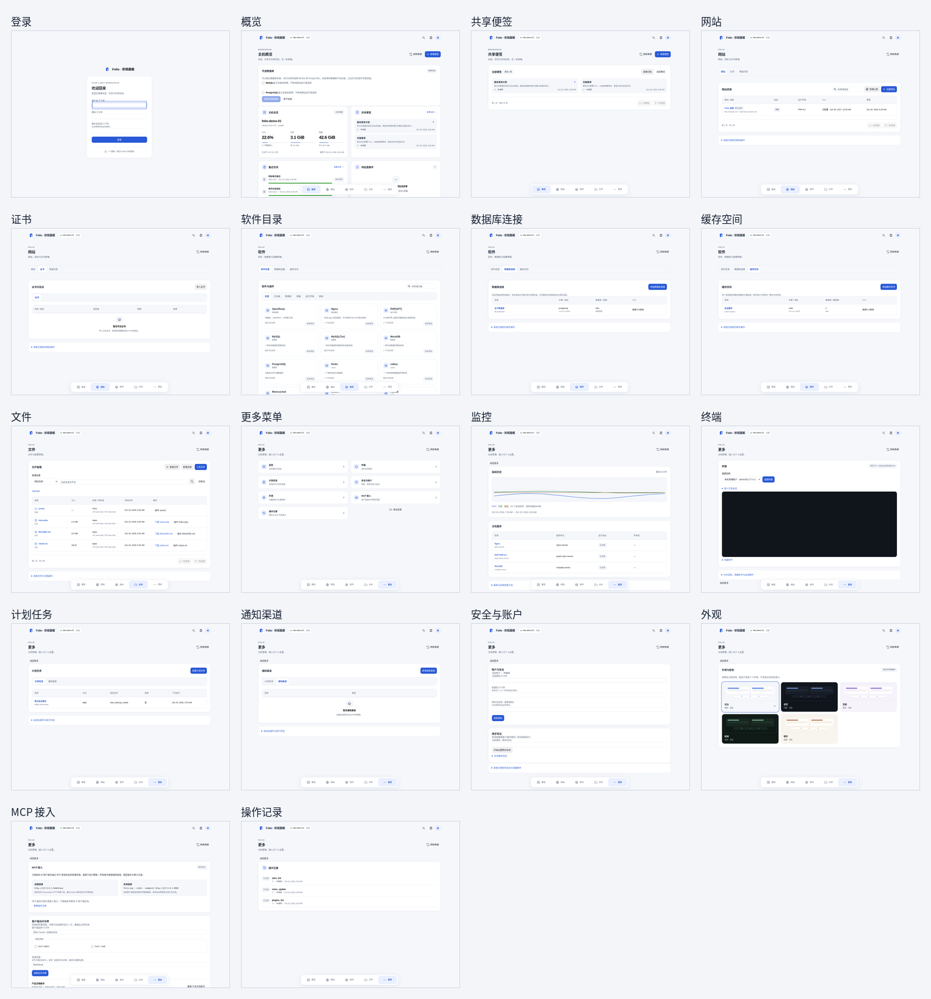

# Folio 面板页面截图

这套截图覆盖当前发布面板中 18 个可见页面，视口为 1440 × 1100。页面由当前工作区构建，并通过隔离的本地只读视觉预览夹具加载。软件目录及其验证状态取自仓库中的 RC15 `core.json`；主机指标、连接、网站、任务、便签和审计记录是样例数据，不是实时主机快照或验收证据。

夹具没有连接验收虚拟机，也没有提交管理操作。长页面附完整滚动图；完整 PNG 和索引也打包在[截图 ZIP](../panel-1.0-beta1-screenshots.zip)中。

| 页面 | 首屏截图 | 完整截图 |
| --- | --- | --- |
| 登录 | [00-login.png](00-login.png) | — |
| 概览 | [01-overview.png](01-overview.png) | [01-overview-full.png](01-overview-full.png) |
| 共享便签 | [02-shared-notes.png](02-shared-notes.png) | — |
| 网站 | [03-sites.png](03-sites.png) | — |
| 证书 | [04-certificates.png](04-certificates.png) | — |
| 软件目录 | [05-software.png](05-software.png) | [05-software-full.png](05-software-full.png) |
| 数据库连接 | [06-database-connections.png](06-database-connections.png) | — |
| 缓存空间 | [07-cache-connections.png](07-cache-connections.png) | — |
| 文件 | [08-files.png](08-files.png) | [08-files-full.png](08-files-full.png) |
| 更多菜单 | [09-more-menu.png](09-more-menu.png) | — |
| 监控 | [10-more-monitor.png](10-more-monitor.png) | [10-more-monitor-full.png](10-more-monitor-full.png) |
| 终端 | [11-more-terminal.png](11-more-terminal.png) | [11-more-terminal-full.png](11-more-terminal-full.png) |
| 计划任务 | [12-more-schedules.png](12-more-schedules.png) | — |
| 通知渠道 | [13-more-notifications.png](13-more-notifications.png) | — |
| 安全与账户 | [14-more-security.png](14-more-security.png) | [14-more-security-full.png](14-more-security-full.png) |
| 外观 | [15-more-appearance.png](15-more-appearance.png) | — |
| MCP 接入 | [16-more-mcp.png](16-more-mcp.png) | [16-more-mcp-full.png](16-more-mcp-full.png) |
| 操作记录 | [17-more-audit.png](17-more-audit.png) | — |
